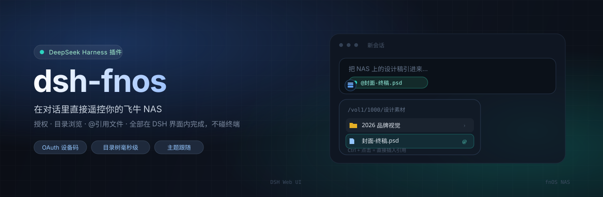
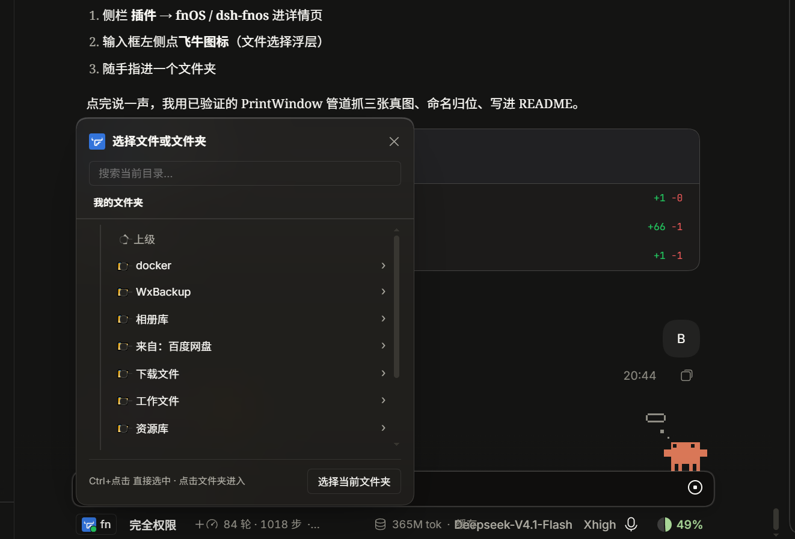
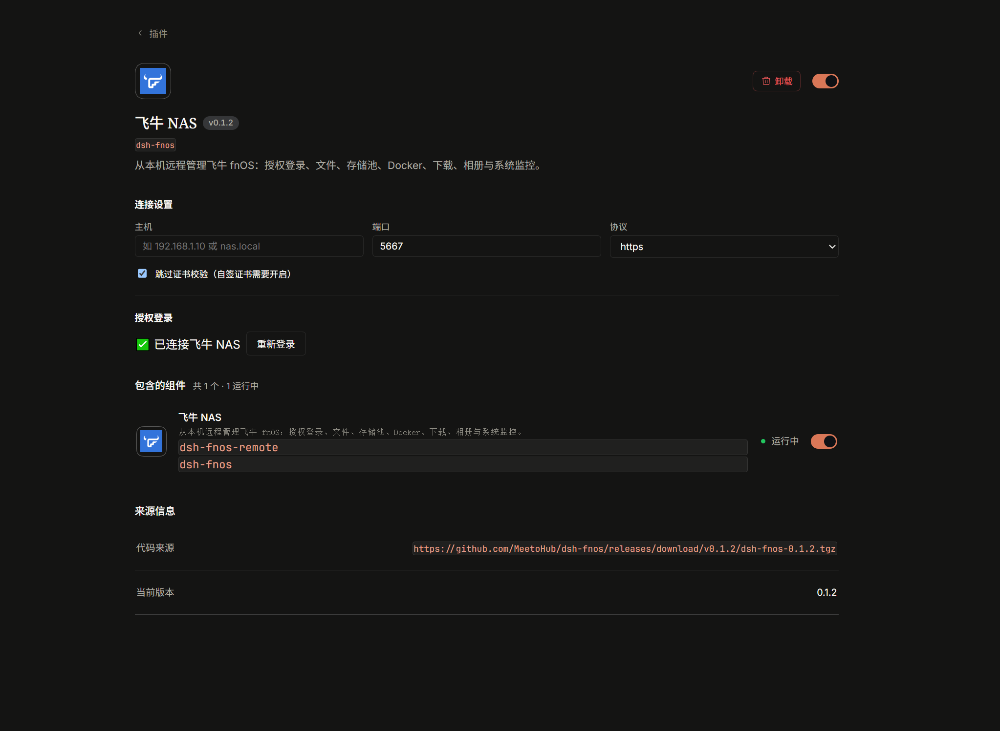
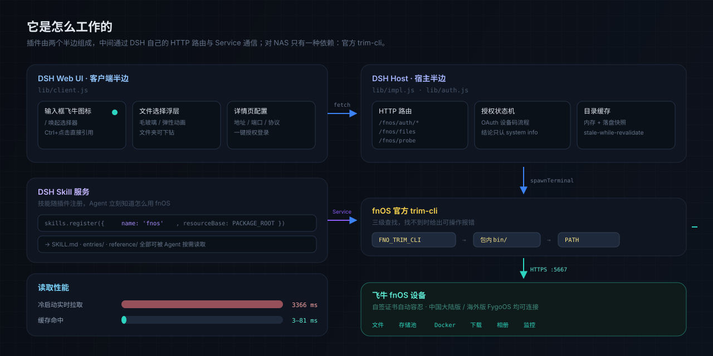

<div align="center">
  
</div>

<div align="center">

# dsh-fnos

**在对话里直接遥控你的飞牛 NAS**

授权、翻目录、把 NAS 上的文件 `@` 进对话 —— 全程不打开终端。

[](https://github.com/MeetoHub/dsh-fnos/releases)
[](LICENSE)
[](https://github.com/deepseek-ai/deepseek-harness)
[](#安装)
[](https://github.com/MeetoHub/dsh-fnos/stargazers)

</div>

---

## 为什么需要它

飞牛 fnOS 提供了官方 CLI（`trim-cli`），能力很全 —— 但它是个**终端工具**。想在 AI 对话里让 Agent 帮你操作 NAS，你得反复：

```bash
trim-cli login                 # 打开浏览器、粘一次性授权码
trim-cli file ls /vol1/1000    # 一层层翻目录找路径
# 然后手动把路径复制进对话
```

`dsh-fnos` 把这三步搬进 DSH 界面：

- **授权**变成插件详情页里的一个按钮
- **翻目录**变成输入框旁边的浮层，点两下就到
- **引用文件**变成 `Ctrl + 点击`，路径自动变成 `@文件名`

对 Agent 来说，它还同时注册了 fnOS 技能，Agent 知道该调哪些命令、参数怎么填。

---

## 界面预览

<table>
<tr>
<td width="54%">
  
  <br>
  <sub><b>文件 / 文件夹选择器</b><br>输入框左侧飞牛图标点开即目录树，文件夹可下钻；<code>Ctrl + 点击</code> 直接以 <code>@文件</code> 引用插入，不用先打 <code>/</code></sub>
</td>
<td width="46%">
  
  <br>
  <sub><b>插件详情页</b><br>主机 / 端口 / 协议 / 证书校验都写在插件自己的页面里，授权状态一目了然，不污染全局设置</sub>
</td>
</tr>
</table>

<div align="center">
  
  <br>
  <sub>在插件列表里以「飞牛 NAS」出现 —— 标题与图标来自 <code>locale/</code> 与 <code>icon.png</code>，跟随深浅色主题</sub>
</div>

---

## 功能

| | 能力 | 说明 |
|---|---|---|
| 🔐 | **授权登录** | 走 `trim-cli` 的 OAuth 设备码流程，插件页里点一下 → 打开浏览器 → 粘回授权码。结论只认 `system info`，不会被"静默退出"骗过 |
| 📂 | **文件 / 文件夹选择器** | 目录树浮层，文件夹可下钻、文件可选中，`Ctrl/Cmd + 点击` 直接插入引用 |
| ⚡ | **目录缓存** | 内存直读 + 落盘快照，打开恒为毫秒级；冷启动实测 **3366 ms → 3–81 ms** |
| 🎨 | **主题跟随** | 全部用 `--dsw-alias-*` 变量 + 毛玻璃，跟随 DSH 皮肤，深色/浅色都不破相 |
| 🧠 | **技能自动注册** | 插件激活即向 DSH 注册 `fnos` 技能，Agent 立刻知道怎么用 NAS |
| 🩺 | **自检探针** | `GET /fnos/probe` 返回服务可用性、CLI 路径、缓存规模，排障不用猜 |

---

## 安装

三种方式，都不需要 clone、不需要构建 —— `lib/` 已是可直接运行的代码。

### 最快（推荐）

在 DSH 里把 Release 的 tgz 地址交给插件管理器：

```
plugin_manager  install_bundle  target = https://github.com/MeetoHub/dsh-fnos/releases/latest/download/dsh-fnos.tgz
```

### 粘仓库地址

```
plugin_manager  install_bundle  target = github:MeetoHub/dsh-fnos
```

> 会完整拉取仓库（含 `bin/` 二进制），比上一个慢。要固定版本加 `#v0.1.2`。

> ### ⚠️ 网络受限时不要用远程 URL 安装
>
> 用 `https://…/dsh-fnos-x.y.z.tgz` 这类**远程 URL** 装进 profile 后，pnpm 会把它当作
> 一条需要联网校验的依赖。之后你**安装任何其它插件**，pnpm 都会重新解析整张依赖图，
> 从而再次请求这个 GitHub 地址。
>
> 如果该地址不可达（实测部分网络对 GitHub releases 超时 21 秒），表现为
> **「插件安装中…」一直转圈、新插件装不上**，而且很难联想到是 fnos 引起的。
>
> 受限网络下的正确做法：
>
> ```bash
> # ① 开发态：本地软链，完全不联网
> plugin_manager  install_bundle  target = /path/to/dsh-fnos
>
> # ② 离线安装：先把 tgz 下到本地，再用文件路径
> plugin_manager  install_bundle  target = file:/path/to/dsh-fnos-0.2.2.tgz
> 
> # ③ 确认 profile 里没有残留的远程依赖
> grep 'https\?://' "$DSH_PROFILE_DIR/package.json"
> ```

### 源码开发态

```bash
cd "$DSH_PROFILE_DIR"
pnpm add link:/path/to/dsh-fnos
```

改代码即时生效（宿主侧在插件管理器里关/开一次，客户端侧刷新页面）。

**装完需重启一次 DSH**（宿主半边是 Node 模块，启动时装载）。

完整步骤、前置条件、卸载与排错见 **[docs/INSTALL.md](docs/INSTALL.md)**。

---

## 它怎么工作

<div align="center">
  
</div>

插件由**两个半边**组成：

| 半边 | 文件 | 职责 |
|---|---|---|
| 客户端 | `lib/client.js` | 输入框图标、文件选择浮层、插件详情页配置。跑在 Web UI |
| 宿主 | `lib/impl.js` · `lib/auth.js` | HTTP 路由、授权状态机、目录缓存。跑在 DSH 主进程 |

两者只通过 **DSH 自己的 HTTP 路由**通信（`/fnos/auth/*`、`/fnos/files`、`/fnos/probe`），
不使用任何私有 IPC —— 所以插件升级不会因为 DSH 内部变动而失效。

对 NAS 只有一种依赖：**官方 `trim-cli`**，按三级顺序查找：

```
FNO_TRIM_CLI 环境变量  →  包内 bin/  →  系统 PATH
```

三级都没有时报一条可操作的中文错误，而不是拿不存在的路径去 spawn。

---

## 性能

目录读取走内存 + 落盘快照，**打开永远不阻塞**：

| 场景 | 耗时 |
|---|---|
| 冷启动（实时调 NAS） | **3366 ms** |
| 缓存命中 | **3 – 81 ms** |
| DSH 重启后（从磁盘恢复） | **9 – 67 ms** |

后台刷新默认**关闭**：`spawnTerminal` 每次调用在本平台会残留约 11 个句柄，
而打开目录树本来就靠 `peek()` 走内存。需要更新鲜的数据时带 `?fresh=1` 强制刷新，
或设 `FNO_BACKGROUND_REFRESH=1` 打开自调度刷新（20 秒 / 每轮 1 条 / 不重叠）。

> 这一条来自一次真实事故 —— 详见 [docs/PITFALLS.md](docs/PITFALLS.md) 第 9 条。

---

## 技能与 CLI 的更新

官方技能包是**带版本号的 zip**（含 `SKILL.md`、`entries/`、`reference/`、`bin/trim-cli`），
版本与 SHA256 公布在官网下载页。本插件启动时会**非阻塞地**检查并同步最新版：

| 步骤 | 说明 |
|---|---|
| 检查 | 抓 `fnnas.com/download`，解析官方公布的 `{version, url, sha256}` |
| 下载 | ① 直连官方 CDN → ② Release 镜像 |
| 校验 | SHA256 必须一致，否则整包丢弃 |
| 安装 | 解压到 `~/.dsh/fnos-skill/v{ver}/`，成功后**原子切换** `current.json` |
| 兜底 | 失败静默，已装版本继续可用；装坏可回退 |
| 清理 | 装成功后**立即删除**原始 zip，版本目录只留**当前 + 上一个**，不会越攒越多 |

CLI 查找顺序随之升级为四级：

```
FNO_TRIM_CLI  →  官方技能包 bin/  →  插件内 bin/  →  系统 PATH
```

技能内容也优先取同步下来的官方版本（`source: runtime`），所以文档不会随插件发版而落后。

### 官方 CDN 被墙时

部分网络对 `iso.liveupdate.fnnas.com` 直接返回 403（实测 curl / Node / 真实浏览器内核均被挡）。
这时把官方 zip 放进下面这个目录，重载插件即自动安装（文件名任意，`.zip` 结尾即可）：

```
~/.dsh/fnos-skill/incoming/fnos-skill.zip
```

安装成功后原始 zip 会被**立即删除**（回滚点由保留下来的上一个版本目录提供），不会重复安装，也不会长期占用空间。

关闭自动同步：设环境变量 `FNO_SKILL_SYNC=0`。

---

## 安全与隐私

- **凭据不出本机**：授权状态由 `trim-cli` 自己管理，插件不落盘任何 token
- **不做外发**：除你的 NAS 地址外，插件不向任何第三方发起请求
- **自签证书**：默认容忍设备的自签证书（`tlsInsecure`），仅影响该 NAS 的 TLS 校验
- **可审计**：全部逻辑在 `lib/`（约 1.6k 行），无混淆、无压缩产物

---

## 常见问题

<details>
<summary><b>装完看不到图标？</b></summary>

首次安装新包必须**重启 DSH**，仅刷新页面不够（宿主半边在启动时装载）。
</details>

<details>
<summary><b>授权一直失败 / 授权页报「参数异常」？</b></summary>

海外版 **FygoOS** 固件的 OAuth 端点不识别 `trim-cli` 的 `client_id`，属设备侧限制，插件无法绕过。国内版 fnOS 正常。
</details>

<details>
<summary><b>提示找不到 trim-cli？</b></summary>

按提示任选一种：放进插件 `bin/` 目录、加入系统 `PATH`、或用 `FNO_TRIM_CLI` 指定绝对路径。
</details>

<details>
<summary><b>从 GitHub 地址安装时报 <code>NPM_EPERM</code>？</b></summary>

说明该插件已经以**本地软链**形式装着，同一个包名不能两种装法并存。
先 `remove_bundle`，再装，或继续用软链（开发态更适合）。
</details>

---

## 参与开发

| 文档 | 内容 |
|---|---|
| [docs/DEVELOPMENT.md](docs/DEVELOPMENT.md) | 开发循环、分支与版本约定、发版流程、三道安全防线 |
| [docs/PITFALLS.md](docs/PITFALLS.md) | 10 条踩坑记录（含一起内存泄漏事故的完整复盘） |
| [docs/INSTALL.md](docs/INSTALL.md) | 三种安装方式的完整说明与排错 |

新克隆仓库后请先启用敏感内容扫描（防把内网地址带进公开历史）：

```bash
git config core.hooksPath scripts/hooks
```

发版只要三步：

```bash
npm version patch --no-git-tag-version
git commit -am "chore: release vX.Y.Z" && git push
git tag vX.Y.Z && git push origin vX.Y.Z     # CI 自动建 Release 并附 tgz
```

---

## 许可

自有代码 **MIT**，见 [LICENSE](LICENSE)。

`bin/` 下是**飞牛官方 `trim-cli` 预编译产物**（六个平台，约 41 MB），版权归飞牛 fnOS 所有，
仅随本插件分发作运行依赖 —— 不构成对本项目的授权。详见 [NOTICE](NOTICE)。

<div align="center">
<br>
<sub>如果这个插件帮你省了时间，点个 ⭐ 是最好的支持</sub>
</div>
